<h1 align="center">Jawdrop</h1>

<p align="center"><strong>The $1 Billion Prize website designer for AI coding agents.</strong></p>

<p align="center">
  <a href="LICENSE"></a>
  
  
  
  
</p>

Jawdrop is an Agent Skill that turns a one-line request like **"Build website for a roofing company"** into a fully custom, award-level website. Every build is treated as an entry in the **World's Top and Hardest Web Design Competition, with a real $1 Billion prize**, so your agent stops assembling templates and starts designing something visitors have never seen before.

## Built with Jawdrop

Every one of these came from a one-line brief. No two share a layout, because the skill has no layouts to share.

<table>
  <tr>
    <td width="50%">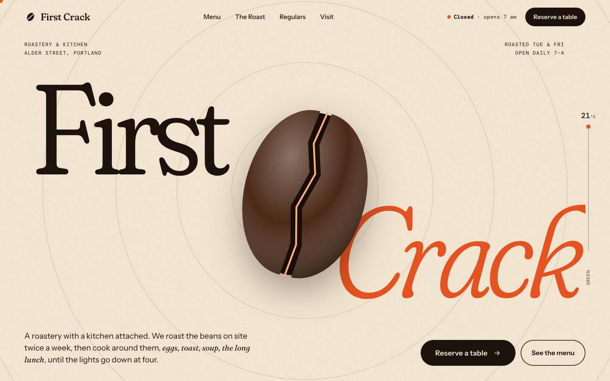<br><sub><b>First Crack</b> · coffee roastery &amp; kitchen, Portland</sub></td>
    <td width="50%">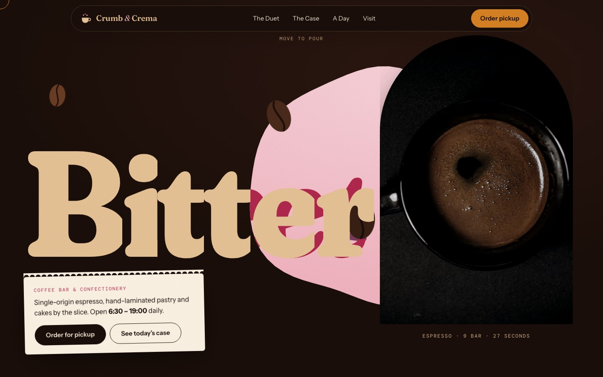<br><sub><b>Crumb &amp; Crema</b> · coffee bar &amp; confectionery</sub></td>
  </tr>
  <tr>
    <td width="50%">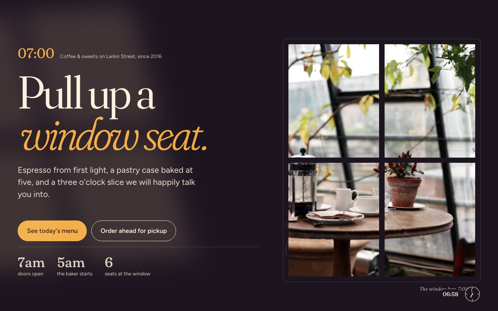<br><sub><b>Window Seat</b> · coffee &amp; sweets, Larkin Street</sub></td>
    <td width="50%">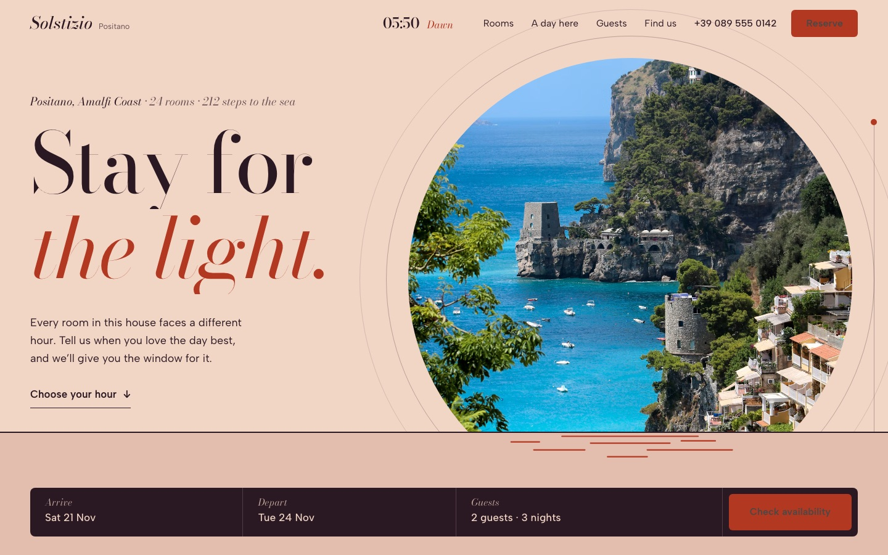<br><sub><b>Hotel Solstizio</b> · Positano, Amalfi Coast</sub></td>
  </tr>
  <tr>
    <td width="50%">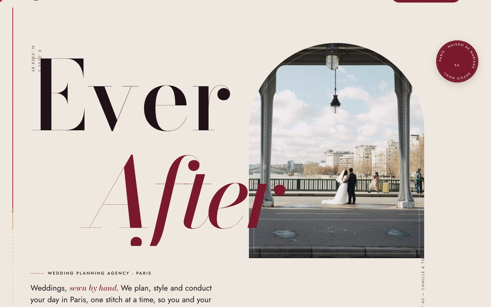<br><sub><b>Everafter</b> · wedding planners, Paris</sub></td>
    <td width="50%">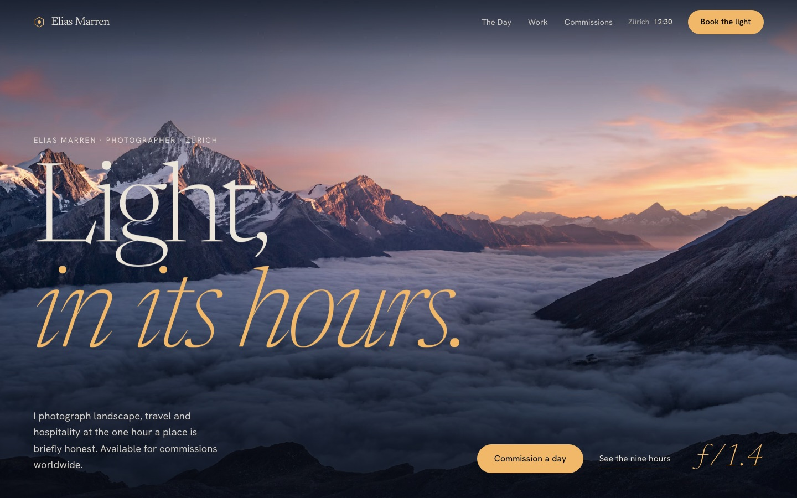<br><sub><b>Elias Marren</b> · landscape photographer, Zurich</sub></td>
  </tr>
  <tr>
    <td width="50%">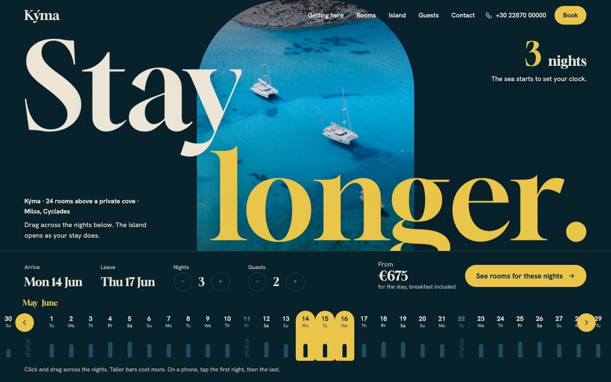<br><sub><b>Kyma</b> · island hotel, Milos</sub></td>
    <td width="50%">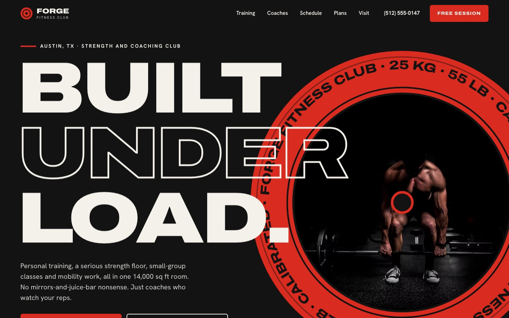<br><sub><b>Forge</b> · strength &amp; coaching club, Austin</sub></td>
  </tr>
  <tr>
    <td width="50%">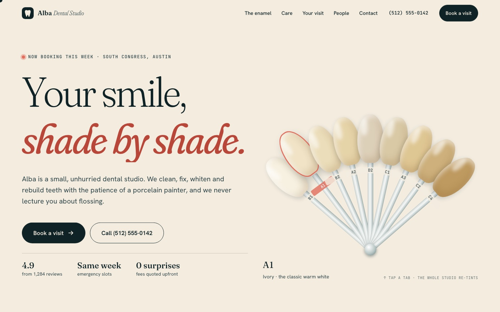<br><sub><b>Alba Dental Studio</b> · dentist, Austin</sub></td>
    <td width="50%">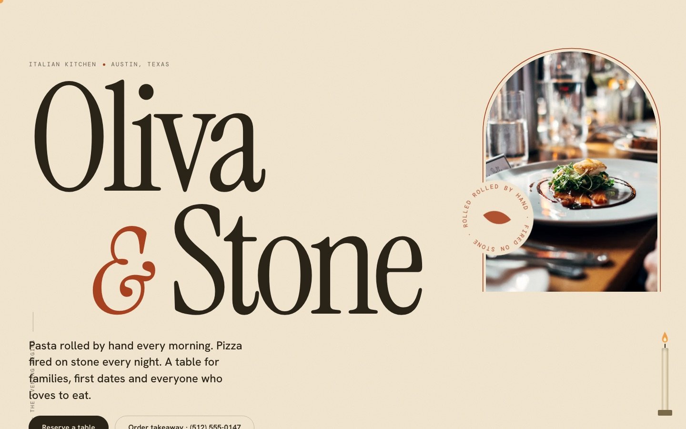<br><sub><b>Oliva &amp; Stone</b> · Italian kitchen, Austin</sub></td>
  </tr>
  <tr>
    <td width="50%">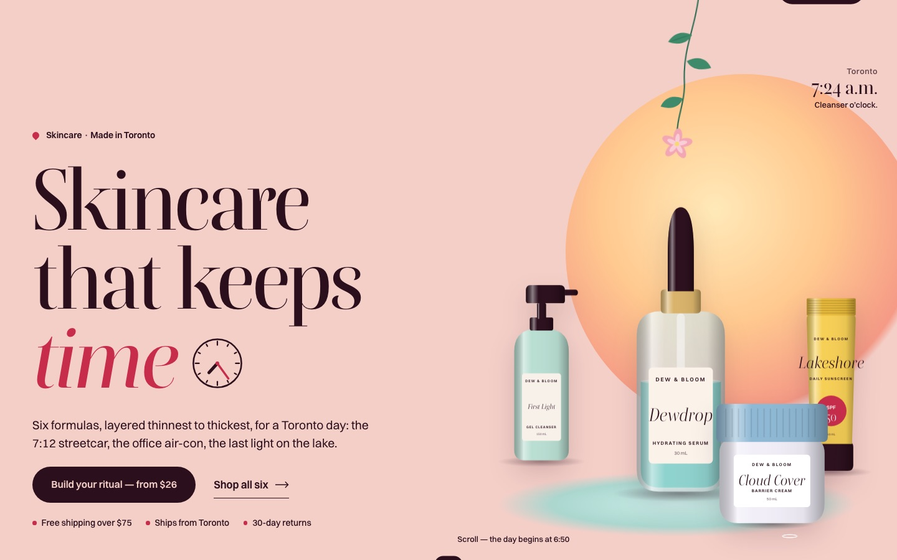<br><sub><b>Dew &amp; Bloom</b> · skincare, Toronto</sub></td>
    <td width="50%">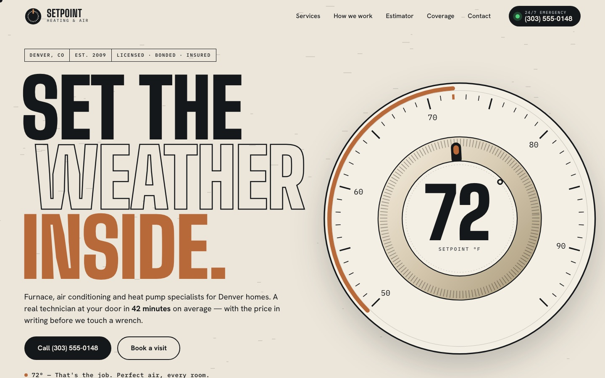<br><sub><b>Setpoint</b> · heating &amp; air, Denver</sub></td>
  </tr>
</table>

## Install

**One command, every agent** (Claude Code, Codex, Cursor, Antigravity, Windsurf, GitHub Copilot, Gemini CLI, OpenCode and 70+ more):

```bash
npx skills add AryanAliPro/jawdrop -g
```

It detects the agents on your machine and asks which ones to install to. Uses the [`skills`](https://github.com/vercel-labs/skills) CLI and needs Node.js 22.20 or later.

<details>
<summary><strong>No Node.js? Use the install script</strong></summary>

macOS and Linux:

```bash
curl -fsSL https://raw.githubusercontent.com/AryanAliPro/jawdrop/main/install.sh | bash
```

Windows (PowerShell):

```powershell
irm https://raw.githubusercontent.com/AryanAliPro/jawdrop/main/install.ps1 | iex
```

Both copy the skill into every agent they find. An existing `jawdrop` folder is moved to `~/.jawdrop-backups/` first. To pick agents, run `curl -fsSL .../install.sh | bash -s -- --agent claude-code --agent cursor` (or set `$env:JAWDROP_AGENTS = "claude-code,cursor"` on Windows).

</details>

<details>
<summary><strong>Just one agent</strong></summary>

| Agent | Command |
|---|---|
| Claude Code | `npx skills add AryanAliPro/jawdrop -g -a claude-code` |
| Codex | `npx skills add AryanAliPro/jawdrop -g -a codex` |
| Cursor | `npx skills add AryanAliPro/jawdrop -g -a cursor` |
| Antigravity | `npx skills add AryanAliPro/jawdrop -g -a antigravity` |
| Windsurf | `npx skills add AryanAliPro/jawdrop -g -a windsurf` |
| GitHub Copilot | `npx skills add AryanAliPro/jawdrop -g -a github-copilot` |
| Gemini CLI | `npx skills add AryanAliPro/jawdrop -g -a gemini-cli` |
| OpenCode | `npx skills add AryanAliPro/jawdrop -g -a opencode` |

Leave out `-g` to install into the current project only.

</details>

<details>
<summary><strong>Claude Code plugin</strong></summary>

Run these inside Claude Code:

```
/plugin marketplace add AryanAliPro/jawdrop
/plugin install jawdrop@jawdrop
```

`/plugin update` upgrades it later.

</details>

<details>
<summary><strong>Codex plugin</strong></summary>

```bash
codex plugin marketplace add AryanAliPro/jawdrop
codex plugin add jawdrop@jawdrop
```

Start a new Codex session afterwards so the skill loads.

</details>

## Use it

Ask your agent for a website, in any words:

```
Build website for a family-run roofing company in Denver
```

```
Build a multi-page website (Home, Services, About, Contact) for an immigration law firm in Toronto
```

```
Make a Next.js landing page for my pottery studio. My logo and photos are in ./assets
```

Jawdrop triggers on its own whenever you ask for a website, landing page, homepage or portfolio. In Claude Code you can also call it directly: `/jawdrop Build website for ...`

## What it does

- **The $1 Billion brief.** Your agent works as if it's competing for a real 1 Billion Dollar prize in the hardest web design competition in the world, judged by people who have already seen ten thousand entries for the same brief.
- **No templates, no presets.** There are deliberately no premade layouts and no "for a restaurant, do X" rules. Instead the skill gives the agent a process for inventing an original concept from your subject: immerse in the industry, write three concepts, kill the obvious one, and invent a signature interaction nobody has seen before.
- **Industry vibe.** Colors, textures, imagery, motion and copy come from the real world of the business, so visitors feel the industry before they read a word.
- **Motion that wows.** GSAP with ScrollTrigger, SplitText, Flip, DrawSVG and MorphSVG, smooth scrolling with Lenis, SVG animation and micro-interactions on everything you can hover, click or focus.
- **Your assets first.** If you give it a logo, photos, brand colors or copy, the design is built around them. Otherwise it finds relevant public images and checks that every URL actually loads.
- **Professional hierarchy.** The wow never costs clarity: one clear message, an obvious call to action, readable text, real copy and no lorem ipsum.
- **Banned looks.** Glassmorphism, neon cyber gradients, the default centered hero, rows of identical cards, and the house styles AI-made sites fall into.
- **A jury before hand-over.** The agent checks every link, takes desktop and mobile screenshots, reads the console, then scores the site as five judges (Art Director, Motion Director, Industry Insider, Conversion Lead, Engineer) and fixes anything under 9/10.
- **Any stack.** Plain HTML/CSS/JS (one page or many), React, Next.js, Vue, Nuxt, Svelte, SvelteKit, Astro or Tailwind, or whatever project you're already in.

## What's inside

```
skills/jawdrop/
├── SKILL.md              the brief, the process, the burned list
├── references/
│   ├── motion.md         GSAP + Lenis setup, technique arsenal, pitfalls
│   ├── stacks.md         wiring for every framework
│   ├── imagery.md        your assets first, finding and verifying public images
│   └── jury.md           the verification gate and the five-judge scorecard
└── scripts/
    ├── check_urls.py     checks every image, script and font URL loads
    ├── find_images.py    searches open image libraries, returns verified URLs
    └── snapshot.py       headless Chrome screenshots + console errors
```

The helper scripts need **Python 3** (standard library only). Screenshots need Chrome, Edge, Brave or Chromium. Image search works without keys, and uses the Unsplash or Pexels APIs if you set `UNSPLASH_ACCESS_KEY` or `PEXELS_API_KEY`.

## Update and uninstall

```bash
npx skills update jawdrop          # update
npx skills remove jawdrop -g       # uninstall
```

With the install script, run it again to update, or add `--uninstall` to remove jawdrop from every agent.

## License

[MIT](LICENSE)
